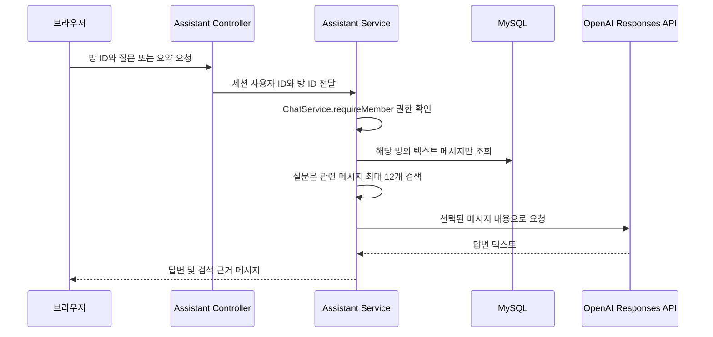

# 대화방 AI 요약·질문

## 기능 범위

대화방 상단의 **AI 요약·질문** 버튼에서 최근 대화 요약과 대화 기록 질문을 사용할 수 있습니다. AI 제공자는 OpenAI Responses API이며 키는 브라우저로 보내지 않고 Spring Boot 서버에서만 사용합니다.

현재 구현은 벡터 임베딩 기반 RAG가 아니라 **키워드 검색형 RAG의 첫 단계**입니다. 해당 방의 최근 텍스트 메시지를 MySQL에서 최대 500개 읽고, 질문에 포함된 단어가 들어 있는 메시지 중 점수가 높은 최대 12개를 근거로 골라 모델에 전달합니다. 질문과 일치하는 근거가 없으면 AI 요청을 보내지 않고 “대화에서 관련 내용을 찾지 못했어요.”를 반환합니다. 질문 답변 아래에는 모델이 아니라 서버가 검색한 실제 근거 메시지를 표시합니다.

요약은 해당 방의 최근 텍스트 메시지 최대 150개를 시간순으로 모델에 전달합니다. 메시지 한 건당 전송할 텍스트는 최대 2,000자, 전체 입력은 최대 40,000자로 제한합니다. 질문 검색은 최대 500개를 후보로 보고 최대 12개 근거를 선택하며, 선택한 각 메시지도 2,000자 이하이고 전체 입력은 최대 40,000자입니다. 이미지와 음성 파일의 본문은 읽거나 전송하지 않습니다.

## 요청 흐름과 권한



`ConversationAssistantController`는 로그인 세션의 사용자 ID를 받고, `ConversationAssistantService`는 매 요청마다 `ChatService.requireMember(conversationId, userId)`를 먼저 실행합니다. 참여 권한이 없으면 검색이나 외부 AI 요청 전에 403으로 끝납니다. 메시지 SQL도 요청한 `conversation_id`만 대상으로 합니다.

## 설정

1. `deploy/.env.example`을 참고해 저장소에서 무시되는 `deploy/.env`에 AI 설정을 넣습니다.

   ```dotenv
   OPENAI_API_KEY=서버에서_사용할_API_키
   OPENAI_MODEL=계정에서_사용할_수_있는_Responses_API_모델_ID
   ```

2. 로컬은 `bash deploy/run-local.sh`를 다시 실행합니다. 스크립트가 위 두 값을 Spring Boot 프로세스 환경변수로 전달합니다.
3. 운영은 `deploy/.env`를 배포 호스트에 안전하게 저장하고 `bash deploy/deploy.sh`를 실행합니다. Compose가 두 슬롯에 변수를 전달합니다. 새 배포가 끝나면 활성 슬롯에서 설정을 사용할 수 있습니다.
4. 브라우저에서 로그인하고 대화방을 연 다음 **AI 요약·질문**을 선택합니다.

API 키는 채팅에 붙여넣거나 Git에 커밋하지 마세요. 이미 실행 중인 앱은 `.env` 변경을 자동으로 읽지 않으므로 재시작 또는 재배포해야 합니다. 모델 이름은 계정에서 사용할 수 있는 Responses API 모델 ID로 입력하세요. OpenAI는 API 키를 서버 측 환경변수나 비밀 저장소에서 읽도록 안내합니다. [API 키 안전 관리](https://developers.openai.com/api/docs/guides/production-best-practices)

## 데이터 전송과 한계

- AI 기능 창에서 대화 메시지 일부가 OpenAI API로 전송된다는 점을 사용자에게 알립니다. 서버 요청은 Responses API의 `store: false`를 지정하지만, 이를 서비스 제공자의 모든 보안·보존 정책을 대체하는 설정으로 간주하면 안 됩니다. 실제 운영 전에 [Responses API 문서](https://developers.openai.com/api/docs/guides/text)와 계정의 데이터 제어 조건을 확인하세요.
- 대화방 메시지는 개인 데이터일 수 있습니다. 운영 공개 전에 참여자에게 AI 전송 사실과 사용 목적을 안내하고, AI 기능 사용 동의 또는 비활성화 정책을 정하세요.
- 키워드 검색은 표현이 다르거나 동의어인 문장을 놓칠 수 있습니다. 관련 메시지를 못 찾으면 답변하지 않도록 했지만, 검색된 근거가 있더라도 모델 답변이 틀릴 가능성은 남습니다. 화면에 표시된 근거를 확인하세요.
- 현재는 임베딩/벡터 DB, 재순위화, 대화 요약 저장, 사용자별 사용량 제한, 호출 속도 제한, 관리자별 AI 비활성화가 없습니다. 공개 서비스에 적용하기 전에 비용 한도와 남용 방지 정책을 추가해야 합니다.
- 요청 입력과 메시지 길이를 제한했지만, 동시 사용자 수나 토큰 비용을 제한하는 quota는 아직 없습니다. OpenAI 계정의 사용량 한도와 알림도 설정하세요.

## 구현 위치

- `ConversationAssistantController`: 요약·질문 HTTP API와 로그인 사용자 세션 연결
- `ConversationAssistantService`: 방 권한 검사, 키워드 기반 근거 검색, 프롬프트 작성 및 응답 구성
- `MessageRepository.findRecentTextForAssistant`: 방 한 곳의 일반 텍스트 메시지만 제한 조회
- `OpenAiResponsesClient`: 서버에서 API 키를 사용해 Responses API 호출, 응답 텍스트 추출
- `index.html`: AI 실행 버튼, 사용자 안내, 답변 및 검색 근거 표시
- `application.properties`: `OPENAI_API_KEY`, `OPENAI_MODEL` 환경 변수 바인딩
- `deploy/run-local.sh`, `deploy/compose.yml`: 로컬 실행과 blue/green 컨테이너에 환경변수 전달

## 다음 확장 단계

1. 메시지를 적절한 크기의 청크로 나누고 OpenAI 임베딩을 생성합니다.
2. 임베딩과 대화방 ID, 메시지 ID를 저장하고 방 ID 조건을 포함해 벡터 검색합니다. MySQL 벡터 인덱스 또는 별도 벡터 저장소를 평가할 수 있습니다.
3. 후보 메시지를 재순위화하고 관련 문장만 모델 컨텍스트에 넣습니다.
4. 데이터 삭제·보존 정책, 비용/호출 제한, 동의 및 감사 로그를 설계합니다.
5. 질문 세트와 기대 근거를 만들어 검색 정확도, 근거 적합성, 모르는 질문 거절률을 측정합니다.

새 검색 저장소를 추가할 때도 **대화방 ID 필터와 참여자 권한 검사를 검색 앞단에 유지**해야 합니다. 방 ID만으로 다른 참여자의 임베딩이나 메시지를 검색해서는 안 됩니다.
