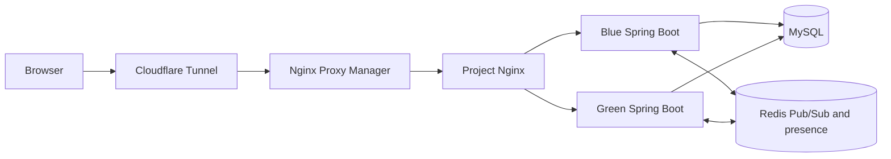

# 모여톡 — 실시간 개인·그룹 채팅

Spring Boot와 WebSocket으로 구현한 서버 저장형 채팅 애플리케이션입니다. OAuth 로그인부터 참여자별 대화 권한, 메시지·첨부 저장, Redis를 통한 blue/green 슬롯 간 실시간 전달, Docker 무중단 배포까지 한 프로젝트에서 다룹니다.

## 데모

- 운영 사이트: https://chatting.ljbhomeserver.date
- 데모 계정과 실제 화면 캡처를 추가할 자리: 로그인 화면, 1:1 대화, 그룹 대화, 모바일 화면
- 배포가 중지되었거나 OAuth 제공자 설정이 바뀌면 데모 주소에 접속할 수 없을 수 있습니다. GitHub 공개 저장소에는 비밀값, 실제 사용자 대화, 개인정보를 포함하지 않습니다.

## 주요 기능

- Google 및 Kakao OAuth 로그인, JDBC 기반 공유 세션
- 개인 사용자 검색, 1:1 및 그룹 대화방 생성과 참여자 권한 검사
- WebSocket 실시간 메시지 전달 및 Redis Pub/Sub 기반 다중 앱 슬롯 이벤트 전달
- MySQL 메시지 기록 저장과 다시 접속했을 때의 기록 조회
- Redis 만료형 presence 데이터로 대화방 접속 사용자 수 집계
- 프로필 사진 및 이미지·음성 메시지 업로드
- 1:1 대화방 나가기 시 종료 상태 저장, 상대방 실시간 안내, 양쪽 메시지 전송 차단
- 그룹 대화방 참여자 목록과 메시지별 미읽음 참여자 수 표시
- Docker Compose blue/green 배포와 health check를 통한 트래픽 전환

## 기술 구성

| 영역 | 사용 기술 | 역할 |
| --- | --- | --- |
| 서버 | Java 21, Spring Boot 4 | API, 서비스 규칙, OAuth 보안 |
| 데이터베이스 | MySQL 8.4, JdbcTemplate, Flyway | 사용자, 대화방, 메시지와 스키마 버전 관리 |
| 실시간 통신 | WebSocket, Redis Pub/Sub | 브라우저 연결 및 앱 슬롯 사이 이벤트 전달 |
| 세션·접속 상태 | Spring Session JDBC, Redis Sorted Set | 슬롯 간 로그인 세션 공유, 접속자 집계 |
| 웹 화면 | HTML, CSS, JavaScript | 채팅 목록과 반응형 대화 화면 |
| 배포 | Docker Compose, Nginx, Cloudflare Tunnel, Nginx Proxy Manager | blue/green 슬롯, 프록시와 외부 HTTPS 진입 |
| 관측 | Spring Boot Actuator | 헬스 체크와 배포 readiness 확인 |

## 아키텍처와 핵심 설계



### 메시지 전달

1. 브라우저가 로그인 세션 쿠키를 사용해 WebSocket을 연결하고 대화방 입장을 요청합니다.
2. 서버가 `ChatService`에서 방 참여 권한을 확인합니다.
3. 메시지를 MySQL에 먼저 저장합니다.
4. 저장된 메시지를 Redis Pub/Sub 채널로 발행합니다.
5. 각 앱 슬롯은 이벤트를 받아 그 슬롯에 연결된 해당 방 세션으로 전달합니다.

MySQL을 메시지의 영구 원본으로 사용하고 Redis는 앱 슬롯 간 전달과 접속 상태 집계에 사용합니다. Redis Pub/Sub 자체는 재생 가능한 메시지 큐가 아니므로, 연결이 끊긴 동안 이벤트를 놓친 브라우저는 MySQL 기록을 다시 조회해 동기화합니다.

### 계층 구조

- `controller`: HTTP API 입력과 응답을 처리합니다.
- `service`: 참여자 권한, 방 생성·종료, 메시지 규칙을 처리합니다.
- `repository`: `JdbcTemplate`으로 SQL을 실행합니다.
- `ChatWebSocketHandler`: WebSocket 이벤트와 Redis 이벤트를 연결하며 메시지 검증·저장은 Service에 위임합니다.
- `FileStorageService`: 업로드 크기, MIME 형식, 파일 시그니처, 저장 경로를 확인합니다.

### 아키텍처

| 요구사항 | 설계 선택 | 이유와 비용 |
| --- | --- | --- |
| 사용자별 비공개 대화 | MySQL `conversation_members`를 권한 기준으로 사용하고 Service에서 조회·전송 전에 검사 | 방 ID를 알아도 접근 불가. 주요 REST와 WebSocket 경로 양쪽에서 검사해야 함 |
| 메시지 기록 유지 | 메시지를 MySQL에 저장한 뒤 실시간 이벤트 발행 | 재접속 조회 가능. DB 기록 후 발행 사이에는 이벤트 전달 실패 가능성이 있어 클라이언트의 기록 재조회가 필요 |
| 두 앱 슬롯 간 실시간 전달 | 각 슬롯의 로컬 WebSocket 세션 + Redis Pub/Sub | 연결을 한 서버에 고정하지 않아도 됨. Pub/Sub 자체에는 재생·전달 보장이 없음 |
| blue/green 동안 로그인 유지 | Spring Session JDBC로 세션 공유 | 슬롯 교체 시 로그인 상태 유지. 세션 읽기·쓰기가 DB 부하를 추가 |
| 배포 실패 시 기존 서비스 유지 | 새 슬롯 health check 후 Nginx upstream 전환 | 정상 슬롯을 먼저 확인할 수 있음. 데이터베이스 스키마 변경은 두 버전이 함께 동작하도록 하위 호환성을 고려해야 함 |
| 업로드 파일을 앱 재배포 후에도 보존 | 공유 Docker 볼륨에 파일을 저장하고 DB에는 파일 키·메타데이터 저장 | 컨테이너 재생성에도 유지. DB 백업과 별도로 파일 볼륨 백업이 필요 |

요청 흐름은 `Browser → Controller/WebSocket Handler → Service → Repository → MySQL`이고, 실시간 이벤트는 `저장 성공 → Redis Pub/Sub → 각 슬롯의 WebSocket 세션`입니다. Nginx는 활성 슬롯으로 HTTP와 WebSocket을 전달하며, 앱 슬롯끼리 직접 세션을 공유하지 않습니다.

## SQL 조회 성능 개선(진행중)

대화 목록은 각 방의 마지막 메시지 내용과 마지막 메시지 시각이 필요합니다. 기존 SQL은 이 값을 각각 상관 서브쿼리로 조회해 방별로 메시지 인덱스를 반복 탐색할 수 있었습니다. 이를 MySQL 8.4 `LEFT JOIN LATERAL`의 최신 메시지 한 행 조회로 합쳤고, 정렬 기준을 `created_at DESC, id DESC`로 명시해 같은 시각의 메시지도 순서를 결정할 수 있게 했습니다.

메시지는 저장 시 상한을 두지 않으며, 처음 방을 열 때 최근 100개만 가져옵니다. 이 제한은 초기 화면 조회량을 정하는 것이며 DB의 보존 개수 제한은 아닙니다. 읽음 상태는 방별 사용자 마지막 읽음 시각으로 저장하며, 메시지별 미읽음 참여자 수를 조회해 보낸 메시지 옆에 표시합니다.


```sql
EXPLAIN ANALYZE
SELECT c.id, latest.created_at, latest.body
FROM conversations c
JOIN conversation_members cm ON cm.conversation_id = c.id
LEFT JOIN LATERAL (
    SELECT m.created_at, m.body
    FROM messages m
    WHERE m.conversation_id = c.id
    ORDER BY m.created_at DESC, m.id DESC
    LIMIT 1
) latest ON TRUE
WHERE cm.user_id = '실제 사용자 UUID'
ORDER BY COALESCE(latest.created_at, c.created_at) DESC, c.id DESC;
```


### 배포

배포 스크립트는 현재 슬롯의 반대편을 새 버전으로 실행하고 health check가 통과하면 Nginx upstream을 전환합니다. 두 앱 슬롯은 MySQL, Redis, 업로드 볼륨을 공유합니다. 서버 포트가 아닌 프록시만 외부 진입 경로로 둡니다.

## 보안과 운영 고려

- OAuth 로그인 후 세션 기반으로 사용자를 식별하고 변경 요청은 CSRF 토큰을 검사합니다.
- REST API와 WebSocket 방 입장·메시지 전송에서 대화방 참여자를 확인합니다.
- WebSocket Origin 허용 목록은 `APP_WEBSOCKET_ALLOWED_ORIGINS`로 환경별 관리할 수 있으며 기본값은 로컬 개발 주소와 현재 운영 도메인입니다.
- 첨부 파일은 용량, 허용 MIME, 파일 시그니처를 검사하고 무작위 저장 키를 사용합니다.
- 업로드 다운로드는 로그인 및 방 참여자 검사를 통과해야 합니다.
- 비밀값은 `deploy/.env`에만 두며 Git에 커밋하지 않습니다.
- 채팅 내용은 서버 MySQL에 평문으로 저장됩니다. 종단 간 암호화(E2EE)는 구현되어 있지 않습니다.

## 테스트 및 재현

자동 테스트 실행:

```bash
./gradlew :app:test
```

## 설정

WebSocket Origin을 추가할 때 쉼표로 구분해 `.env`에 설정합니다.

```dotenv
APP_WEBSOCKET_ALLOWED_ORIGINS=http://localhost:*,https://chatting.ljbhomeserver.date,https://staging.example.com
```

## 알려진 제한과 다음 단계

- Redis Pub/Sub은 전달 보장·재생 기능이 없으며, 연결 복구 시 DB 기록 조회가 보완 경로입니다. 더 강한 이벤트 전달 보장이 필요하면 Redis Streams나 별도 메시지 브로커를 검토합니다.
- 브라우저 UI는 정적 HTML/JavaScript 한 페이지이며, 프론트엔드 빌드·타입 검사 파이프라인은 없습니다.
- 메시지 이전 기록 조회는 시간 기준 조회이며 대량 기록을 위한 커서 기반 페이지네이션은 추가할 수 있습니다.
- 차단·신고, 푸시 알림, E2EE는 미구현입니다.
- 운영 DB와 업로드 볼륨은 별도 백업·복구 훈련이 필요합니다.
- Grafana/Prometheus 메트릭 수집, 경보, 부하 테스트는 다음 운영성 개선 항목입니다.


1. 왜 메시지는 MySQL에 먼저 저장하고 Redis Pub/Sub으로 전달하나요?
 MySQL은 대화 기록의 영구 저장소이고, Redis Pub/Sub은 실행 중인 앱 서버 사이에서 실시간 이벤트를 전달하는 통로이기 때문입니다.
메시지를 먼저 MySQL에 저장하면 앱이 재시작되거나 사용자가 나중에 접속해도 기록을 조회할 수 있습니다. 저장에 성공한 뒤 Redis에 발행하면 blue와 green 양쪽 서버가 각자 연결된 브라우저에 메시지를 전달할 수 있습니다.
 Redis Pub/Sub은 이벤트를 보관하지 않기 때문에, 받는 서버가 잠시 끊겨 있으면 이벤트를 놓칠 수 있습니다. 그래서 Redis를 기록의 원본으로 사용하지 않고, DB 저장 + 다시 조회할 수 있는 구조로 둡니다.

2. blue/green 슬롯이 동시에 실행될 때 WebSocket 이벤트와 로그인 세션을 어떻게 공유하나요?
 각 슬롯은 자기 프로세스에 연결된 WebSocket 브라우저 연결을 관리합니다. 슬롯 사이의 전달은 Redis Pub/Sub이 맡습니다.
예를 들어 A가 blue에, B가 green에 연결돼 있으면 A가 보낸 메시지를 blue가 MySQL에 저장하고 Redis에 발행합니다. 두 슬롯은 Redis 이벤트를 구독하므로 green도 이벤트를 받고, B의 WebSocket 연결로 전달합니다.
로그인 세션은 Spring Session JDBC와 MySQL에 저장하므로, 브라우저가 blue에서 green으로 요청을 보내도 두 슬롯이 같은 세션 정보를 읽을 수 있습니다. 즉, WebSocket 연결 자체를 서버끼리 공유하는 것이 아니라, 각자 연결을 유지하면서 Redis로 이벤트를 전달합니다.

3. 방 ID를 아는 것만으로 대화 내용을 조회할 수 없게 권한 검사를 어디에서 하나요?
 주요 검사는 ChatService에서 합니다.
 REST 기록 조회는 getMessages()가 requireMember()를 호출합니다.
 WebSocket 방 입장과 메시지 전송도 ChatWebSocketHandler가 requireMember()를 호출합니다.
 첨부 파일 조회도 getAttachment()에서 참여자 여부를 확인합니다.
참여자가 아니면 403 Forbidden으로 거부합니다. 방 ID는 식별자일 뿐 접근 권한을 주지 않습니다.

4. Redis 이벤트를 놓쳤을 때 저장 기록을 통해 어떻게 복구하나요?
 메시지를 DB에 먼저 저장하기 때문에 브라우저가 이벤트를 놓쳐도 다시 기록을 조회할 수 있습니다. 현재 화면은 주기적으로 마지막 메시지 시각 이후의 기록을 조회하고, 방을 열 때 최근 메시지를 불러옵니다. 조회 결과는 메시지 ID로 중복 표시를 막습니다.
여기서 “복구”는 저장된 메시지를 다시 조회해 화면을 동기화하는 것입니다. Redis Pub/Sub은 누락 이벤트를 재생해 주지 않습니다. 전달 자체의 보장이 더 필요하면 Redis Streams 같은 저장형 메시징 방식을 검토해야 합니다.
 
5. 무중단 배포에서 health check 실패 시 트래픽 전환을 어떻게 막는가?
 배포 스크립트는 새 슬롯을 실행한 뒤 health check가 통과할 때까지 기다립니다. 제한 시간 안에 통과하지 못하면 오류를 내고 종료하며, 그 뒤에 실행되는 Nginx upstream 변경과 reload는 진행하지 않습니다. 따라서 기존 활성 슬롯으로 트래픽이 계속 전달됩니다.

## 저장소 링크

- 실행·운영 안내: [README.md](README.md)
- 주요 서버 코드: `app/src/main/java/chatting/`
- DB 스키마 이력: `app/src/main/resources/db/migration/`
- 배포 구성: `deploy/`
