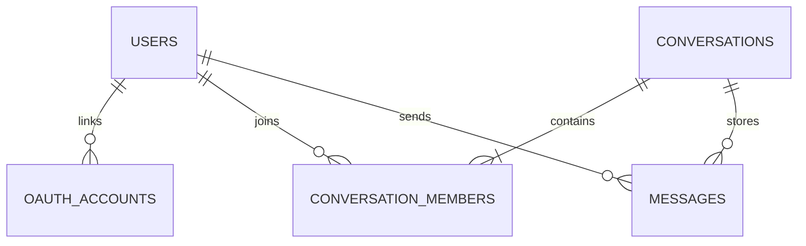

# 모여톡

Java 21과 Spring Boot 4.1.1로 만든 실시간 채팅 앱입니다. 브라우저 화면은 Spring Boot가 제공하고, `/ws` WebSocket 연결로 메시지와 접속 인원 수를 주고받습니다.

## 현재 기능 상태

현재 버전은 **모든 사용자가 함께 보는 공용 채팅방 하나**입니다. OAuth 로그인, 개인 대화방, 데이터베이스 저장은 아직 구현되지 않았습니다. 지금은 서버 메모리에만 접속자 정보가 있고, 메시지도 데이터베이스에 저장하지 않습니다. 개인 정보나 비밀 대화에 사용하면 안 됩니다.

## 개인 대화와 데이터베이스를 추가하는 설계

사용자마다 데이터베이스를 따로 만드는 방식보다 **하나의 PostgreSQL 데이터베이스에 모든 사용자의 데이터를 저장하고, 사용자와 대화방 참여 관계로 접근을 제한하는 방식**을 권장합니다. 메신저에서도 대화 목록, 참여자, 메시지를 연결된 테이블로 저장하고 서버가 요청한 사용자의 권한을 확인합니다. Spring Data JPA는 이 관계형 데이터에 접근하는 저장소 계층을 제공하고, PostgreSQL의 외래 키와 유일 제약 조건으로 관계의 무결성도 지킬 수 있습니다 ([Spring Data JPA](https://docs.spring.io/spring-data/jpa/reference/), [PostgreSQL constraints](https://www.postgresql.org/docs/current/ddl-constraints.html)).

권장 데이터 구조는 다음과 같습니다.

| 테이블 | 저장 내용 |
| --- | --- |
| `users` | 앱 사용자 ID, 닉네임, 프로필 정보, 생성 시각 |
| `oauth_accounts` | 로그인 제공자와 제공자가 발급한 고유 사용자 ID, 연결된 앱 사용자 ID |
| `conversations` | 대화방 ID, 1:1 또는 그룹 대화 종류, 생성 시각 |
| `conversation_members` | 대화방 ID와 사용자 ID, 참여 시각, 마지막으로 읽은 메시지 |
| `messages` | 대화방 ID, 보낸 사용자 ID, 내용, 생성·수정·삭제 시각 |



1:1 대화는 A와 B가 참여자인 `conversations` 행 하나로 표현합니다. 대화 생성 요청이 반복되어 같은 방이 여러 개 생기지 않도록 두 참여자 조합을 정규화해 저장하고, 중복 생성 방지 규칙을 둡니다. 메시지는 `conversation_id`에 연결하고, 방 목록과 이전 대화는 DB에서 페이지 단위로 읽습니다.

### C가 A와 B 대화를 못 보게 하는 핵심

- OAuth 로그인이 끝나면 서버 세션에서 로그인된 앱 사용자 ID를 얻습니다. 브라우저가 보내는 `senderId`나 닉네임은 권한 판단에 사용하지 않습니다.
- 메시지 기록 조회, 메시지 전송, WebSocket 대화방 구독 때마다 `conversation_members`에서 현재 사용자의 참여 여부를 검사합니다.
- 참여자만 메시지를 DB에 저장하고, 해당 대화방을 구독한 참여자에게만 실시간 전달합니다. 방 ID를 추측하거나 알아내도 참여자가 아니면 조회·전송·구독을 거절합니다.
- 메시지는 DB에 성공적으로 저장한 뒤 다른 참여자에게 전송합니다. OAuth 사용자의 식별자는 이메일만으로 묶지 않고 `(제공자, 제공자 고유 사용자 ID)` 조합으로 연결합니다.

Spring Security의 OAuth2 Login을 이용해 Google·Kakao 로그인을 연동할 수 있습니다 ([Spring Security OAuth2 Login](https://docs.spring.io/spring-security/reference/servlet/oauth2/login/)). 각 제공자 개발자 콘솔에서 로컬과 운영 도메인의 로그인 리다이렉트 주소를 등록하고, Client ID와 Secret은 Git에 넣지 않고 환경 변수나 비밀 저장소로 관리합니다. OAuth는 로그인한 사람이 누구인지 확인해주고, 대화방 참여 권한 검사는 별도로 앱에서 구현해야 합니다.

### 권장 구현 순서

1. Compose에 PostgreSQL과 영구 볼륨을 추가합니다. 앱 blue/green 두 컨테이너는 같은 DB를 사용합니다. DB 파일은 앱 컨테이너 안에 두지 않고, 정기 백업도 마련합니다.
2. Spring Boot에 Spring Data JPA와 Flyway를 추가하고 위 테이블을 마이그레이션으로 생성합니다. 운영에서 Hibernate가 임의로 테이블을 바꾸게 두지 않습니다.
3. Spring Security와 OAuth 로그인을 연결해 사용자 생성·기존 계정 연결 및 로그아웃을 구현합니다.
4. 대화 목록, 1:1 대화 생성, 대화 기록 조회 API를 만들고 서버에서 참여자 권한을 검사합니다.
5. WebSocket을 로그인 세션과 연결하고 대화방 구독·메시지 전송마다 같은 권한 검사를 적용합니다. 메시지는 먼저 DB에 저장한 뒤 방 참여자에게 전달합니다.
6. 읽음 표시, 안 읽은 메시지 수, 차단·신고, 계정 삭제와 데이터 보관 정책을 추가합니다.

메시지를 서버 DB에 저장하는 일반적인 개인 대화는 다른 일반 사용자에게 접근을 막을 수 있지만, 서버 운영자는 저장된 평문에 접근할 수 있습니다. 운영자도 내용을 읽을 수 없게 하려면 종단 간 암호화(E2EE)를 별도 설계해야 합니다. 이는 로그인이나 DB 암호화와 다른 기능입니다.

blue/green 배포에서는 두 앱 버전이 같은 DB를 공유합니다. 배포마다 데이터를 지우거나 스키마를 되돌리지 않도록 마이그레이션을 이전·신규 앱 버전이 잠시 함께 동작할 수 있게 순차 적용해야 합니다. 나중에 여러 앱 인스턴스에서 온라인 상태와 메시지 전달을 공유하려면 Redis 같은 공용 중계 계층을 추가할 수 있습니다.

## 지금 실행 중인 주소

| 주소 | 용도 | 실행 방법 |
| --- | --- | --- |
| `http://localhost:8080` | Spring Boot 개발 서버 기본 주소 | `./gradlew :app:bootRun` |
| `http://localhost:8081` | Spring Boot 개발 서버를 8081로 실행한 주소 | `SERVER_PORT=8081 ./gradlew :app:bootRun` |
| `http://localhost:8088` | OrbStack Docker 배포본을 Nginx로 전달 | `bash deploy/deploy.sh` 후 유지 |

개발 중인 코드를 바로 확인하려면 8081 개발 서버를 다시 실행하면 됩니다. 실행했던 터미널에서 `Ctrl+C`를 누르면 멈춥니다. OrbStack 배포본은 별도 컨테이너로 `localhost:8088`에서 계속 동작합니다.

이전에 실행한 서버가 아직 8081을 점유하고 있는지 확인하려면 macOS 터미널에서 PID를 찾습니다.

```bash
lsof -nP -iTCP:8081 -sTCP:LISTEN
```

출력된 PID가 내가 실행한 예전 Gradle/Java 서버인지 확인한 다음, 그 PID만 종료합니다. 8081을 쓰는 다른 프로그램이라면 종료하지 마세요.

```bash
kill 12345
```

위 숫자 `12345`를 앞에서 확인한 실제 PID로 바꾸세요.

## blue/green 배포란?

blue와 green은 같은 채팅 앱을 실행하는 컨테이너 두 자리의 이름입니다. 두 버전이 동시에 요청을 처리하는 구조는 아닙니다. 한쪽은 현재 서비스하고, 다른 한쪽은 다음 버전을 준비하는 데 씁니다.

예를 들어 현재 blue가 서비스 중이라면 배포 스크립트가 green에 새 이미지를 실행하고 정상 응답(헬스체크)을 기다립니다. 정상일 때만 Nginx가 새 요청을 green으로 보내도록 설정을 다시 읽습니다. 잠시 뒤 이전 blue 컨테이너를 멈춥니다. 다음 배포는 반대로 진행합니다. 새 버전이 정상 상태가 되지 않으면 기존 서비스 쪽으로 계속 연결합니다. 쉽게 말해 **새 서버를 먼저 준비하고, 확인한 뒤 입구 안내판(Nginx)을 새 서버 쪽으로 바꾸는 방식**입니다.

일반 웹 요청은 끊김을 줄여 교체합니다. 이미 연결된 실시간 WebSocket 채팅은 이전 컨테이너가 종료될 때 재접속할 수 있습니다. 브라우저가 자동으로 다시 연결합니다. 현재 메시지와 접속자 목록은 메모리에 있어 서버 교체나 재시작 때 초기화됩니다.

## Nginx Proxy Manager(NPM)와 Cloudflare 설정

현재 외부 요청은 **Cloudflare Tunnel → NPM → 프로젝트의 Nginx `proxy` → 활성 앱 컨테이너** 순서로 전달되도록 구성했습니다. Cloudflare Tunnel의 Published application route는 공개 호스트명을 내부 서비스에 연결합니다 ([Cloudflare Tunnel 안내](https://developers.cloudflare.com/tunnel/get-started/)).

NPM의 Proxy Host는 다음 값으로 설정합니다.

| 항목 | 값 |
| --- | --- |
| Domain Name | `chatting.ljbhomeserver.date` |
| Scheme | `http` |
| Forward Hostname / IP | `proxy` |
| Forward Port | `80` |
| Access List | Publicly Accessible |
| Block Common Exploits | 켬 |
| Websockets Support | 켬 |

기존 입력값인 `chatting:8088` 대신 `proxy:80`을 써야 합니다. `chatting`은 Docker 네트워크에서 앱을 가리키는 이름이 아니며, 호스트의 `8088` 포트도 NPM 컨테이너 내부에서 접근하는 포트가 아닙니다. NPM이 프로젝트 Docker 네트워크에 연결되도록 설정했고, NPM 컨테이너 안에서 `http://proxy:80/`이 HTTP 200을 반환하는 것까지 확인했습니다.

Cloudflare Tunnel 경로의 Service URL은 `http://npm:80`으로 지정합니다. NPM 컨테이너의 Docker 네트워크 이름이 `npm`이어서 Tunnel 컨테이너가 NPM에 요청을 전달할 수 있습니다. 현재 실행 중인 NPM은 프로젝트 네트워크 `deploy_chat`에도 연결했고, Cloudflare Tunnel 컨테이너는 NPM 네트워크 `proxy`에도 연결했습니다. 두 컨테이너를 새로 만들면 이 수동 네트워크 연결이 사라질 수 있으므로 다시 연결해야 합니다.

Cloudflare Zero Trust 대시보드에서 Tunnel이 연결된 상태인지 확인하고, `chatting.ljbhomeserver.date` 공개 호스트명의 Service URL을 `http://npm:80`으로 설정합니다. Tunnel 토큰은 비밀값이므로 채팅이나 저장소에 올리지 마세요. 실수로 추적 대상인 예제 파일에 입력된 토큰은 출력하지 않고 Git에서 제외된 `deploy/.env`로 옮겼으며, `deploy/.env.example`은 빈 템플릿으로 복구했습니다. 이 프로젝트의 별도 `cloudflared` Compose 서비스는 실행하지 않고 기존 `cloudflared` 컨테이너를 사용합니다.

NPM과 Tunnel 컨테이너를 다시 만든 뒤 이름 확인이 안 되면, 각 컨테이너를 프로젝트 네트워크에 연결합니다.

```bash
docker network connect deploy_chat npm
docker network connect proxy cloudflared
```

이후 앱 코드를 수정해 배포할 때는 `bash deploy/deploy.sh`를 실행합니다. 앱은 `http://localhost:8088`에서도 확인할 수 있고, 외부 사용자는 `https://chatting.ljbhomeserver.date`로 접속합니다. 라우터 포트 포워딩은 필요하지 않습니다.

## 로컬 개발

```bash
SERVER_PORT=8081 ./gradlew :app:bootRun
```

브라우저에서 `http://localhost:8081`을 엽니다. 포트 번호를 지정하지 않고 `./gradlew :app:bootRun`만 실행하면 기본 주소는 `http://localhost:8080`입니다.

기존의 `./gradlew :app:run --args='5001 8081'`은 예전 Java 앱에서 사용하던 명령이라 지금은 맞지 않습니다. Spring Boot로 바꾸면서 Gradle 실행 작업이 `bootRun`으로 바뀌었고, 웹 페이지와 WebSocket이 같은 포트를 사용하므로 `5001`을 따로 지정할 필요도 없습니다. 개발 서버는 실행한 터미널에서 `Ctrl+C`로 멈춥니다.
