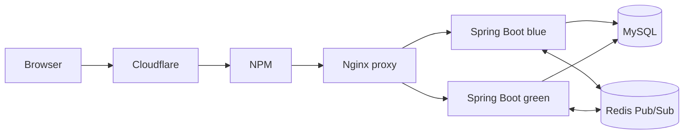

# 모여톡

Java 21과 Spring Boot 4.1.1로 만든 실시간 채팅 앱입니다. Spring Security OAuth 로그인, MySQL 대화·메시지 저장, WebSocket 실시간 전송을 사용합니다.

## 구현된 기능

- Google 또는 카카오 OAuth 로그인을 통해 사용자를 식별합니다.
- Google 로그인을 시작할 때 계정 선택 화면을 요청하므로, 로그아웃 뒤 다른 Google 계정으로 다시 로그인할 수 있습니다. 앱 로그아웃은 Google 자체의 브라우저 세션을 로그아웃하지 않습니다.
- 대화 목록에는 각 로그인 사용자에게 상대방의 닉네임을 대화방 이름으로 보여줍니다.
- 로그인한 사용자가 다른 가입 사용자를 검색해 1:1 또는 그룹 대화방을 만들 수 있습니다. 한 명을 선택하면 1:1, 두 명 이상을 선택하면 최대 50명 그룹방이 됩니다. 그룹 이름은 생성할 때 지정할 수 있습니다.
- 대화방의 `나가기` 버튼으로 현재 사용자만 방에서 나갈 수 있습니다. 1:1 방은 종료 상태로 저장하고 남은 상대방에게 종료 안내를 실시간으로 보여주며, 양쪽의 메시지 전송·첨부 업로드를 막습니다. 나간 사용자의 목록에서는 방이 사라집니다. 그룹방은 한 사용자가 나가도 나머지 참여자가 계속 대화할 수 있습니다. 메시지 기록은 보존됩니다.
- 1:1 상대방이 나가면 Redis Pub/Sub과 WebSocket으로 열린 화면에 즉시 종료 안내를 보냅니다. 화면을 새로고침하지 않아도 메시지 입력과 전송·첨부 버튼이 잠기며, 서버에서도 종료된 방의 메시지를 거부합니다.
- 방 생성 이벤트를 Redis Pub/Sub으로 모든 앱 슬롯에 보내 참여자 화면의 대화 목록을 갱신합니다. 상대방이 로그인해 WebSocket에 연결된 상태라면 새로고침 없이 방이 표시됩니다.
- 새 대화 창에서 사용자 검색어를 바꿔도 이미 선택한 사람은 선택 상태로 유지되며, 선택 목록에서 개별적으로 해제할 수 있습니다.
- 프로필에서 닉네임과 사용자 코드를 확인·수정하고 프로필 사진을 바꿀 수 있습니다. 사용자 코드는 대소문자를 구분하지 않고 3~32자의 영문, 숫자, 밑줄, 하이픈을 허용하며 중복 코드는 거부됩니다.
- 대화방에서 JPEG/PNG/GIF 이미지와 MP3/WAV/OGG/WebM/M4A 음성 파일을 보낼 수 있습니다. 사진은 최대 20MB, 프로필 사진은 최대 5MB입니다. 파일은 무작위 파일명으로 저장되고 대화방 참여자만 첨부 URL을 열 수 있습니다.
- 대화 목록과 이전 메시지는 MySQL에 저장됩니다. 앱 재시작이나 blue/green 교체 후에도 남습니다.
- REST 기록 조회와 WebSocket 구독·전송에서 매번 대화방 참여자 여부를 검사합니다. 방 ID를 알아도 참여자가 아닌 사용자는 기록을 읽거나 메시지를 보낼 수 없습니다.
- 메시지를 MySQL에 저장한 다음 Redis Pub/Sub으로 blue/green 앱 양쪽에 전달합니다. Redis의 만료되는 접속 기록으로 대화방 접속자 수를 합산합니다.
- 메시지 및 접속자 수 이벤트에 대화방 ID를 포함해 브라우저가 현재 열린 방에 맞는 이벤트를 구별합니다.
- HTTP 로그인 세션도 MySQL에 저장해 blue/green 슬롯이 바뀌어도 세션을 공유합니다.

대화방 참여 규칙은 **A가 B를 지정해 방을 만들면 A와 B가 참여자가 되는 방식**입니다. 다른 사용자는 방 목록에 나오지 않습니다. 사용자 검색은 해당 사용자가 OAuth로 한 번 이상 로그인한 뒤부터 가능합니다. 이는 서버 저장형 개인 대화이며 종단 간 암호화(E2EE)는 아닙니다.

사용자 검색은 `GET /api/users?q=검색어`이고, 이미 만든 대화방 목록은 `GET /api/conversations`입니다. 전체 사용자 코드가 정확히 일치하면 그 사용자를 우선 표시합니다. 정확한 코드가 없으면 코드 앞부분과 닉네임을 검색해 후보를 보여주므로, 짧은 코드 앞부분은 여러 사용자와 일치할 수 있습니다. 사용자 코드는 프로필에서 직접 정할 수 있고, 대화방 생성 요청에는 전체 사용자 ID가 전달됩니다.

채팅 화면은 뷰포트 안에 고정되고 대화 목록과 메시지 영역 각각 안에서 스크롤됩니다. Google 계정 선택 요청은 `SecurityConfig`의 `addAccountSelectionPrompt`에서 `prompt=select_account`를 OAuth 인증 요청에 추가합니다.

## 구조



프록시는 외부 요청의 진입점이며 현재 활성 blue 또는 green 컨테이너로 전달합니다. NPM과 Cloudflare가 HTTPS와 도메인을 처리하고, 앱 포트는 인터넷에 직접 공개하지 않습니다. WebSocket 업그레이드 헤더도 Nginx가 전달합니다. Cloudflare Tunnel에서 NPM까지는 `http://npm:80`, NPM에서 이 프로젝트 프록시까지는 `http://proxy:80`입니다. `proxy:80`은 Docker 내부 주소이고 `localhost:8088`은 Mac에서 확인하는 주소라 서로 다른 구간입니다.

## OAuth 설정

비밀값은 저장소에 올리지 않고 Git에서 제외된 `deploy/.env`에 둡니다. `.env.example`을 참고해 다음 키를 채웁니다.

```dotenv
MYSQL_PASSWORD=배포_DB_앱_사용자_비밀번호
MYSQL_ROOT_PASSWORD=배포_MySQL_관리자_비밀번호
MYSQL_TEST_PASSWORD=테스트_DB_앱_사용자_비밀번호
MYSQL_TEST_ROOT_PASSWORD=테스트_MySQL_관리자_비밀번호
GOOGLE_CLIENT_ID=
GOOGLE_CLIENT_SECRET=
KAKAO_CLIENT_ID=
KAKAO_CLIENT_SECRET=
```

Google Cloud Console과 Kakao Developers에 운영 주소의 다음 리다이렉트 URI를 각각 등록합니다.

- Google: `https://chatting.ljbhomeserver.date/login/oauth2/code/google`
- 카카오: `https://chatting.ljbhomeserver.date/login/oauth2/code/kakao`

로컬 OAuth 테스트를 할 때는 각 콘솔에 `http://localhost:8080/login/oauth2/code/google` 또는 `/kakao`도 추가합니다. OAuth Client ID와 Secret을 설정하지 않은 상태에서는 로그인 버튼은 보이지만 제공자 인증이 완료되지 않습니다.

Google OAuth 클라이언트 유형은 **Web application**이어야 하며, 승인된 리디렉션 URI는 실제 접속 주소와 정확히 일치해야 합니다. 로컬 앱에서는 `http://localhost:8080/login/oauth2/code/google`, 운영에서는 `https://chatting.ljbhomeserver.date/login/oauth2/code/google`을 등록합니다. 로컬에서 `127.0.0.1`로 접속하면 localhost와 다른 URI이므로 그 주소도 별도로 등록해야 합니다. Google의 OAuth 동의 화면이 Testing 상태라면 로그인할 Google 계정을 테스트 사용자로 추가하세요. Client ID/Secret을 `.env`에 수정한 뒤 이미 실행 중인 앱에 반영하려면 앱을 재시작하거나 다시 배포해야 합니다. [Google Web Server OAuth 문서](https://developers.google.com/identity/protocols/oauth2/web-server)는 리디렉션 URI가 등록된 값과 정확히 같아야 한다고 안내합니다.

OAuth가 실패하면 오류 화면의 코드를 먼저 확인하세요. `redirect_uri_mismatch`는 실제 주소와 Google Console의 승인 URI가 다르다는 뜻입니다. `access_denied`는 OAuth 동의 화면이 Testing 상태일 때 로그인 계정이 테스트 사용자에 없을 수 있습니다. `invalid_client`라면 Web application 클라이언트의 ID/Secret 쌍인지, `.env`를 바꾼 뒤 앱을 재시작했는지 확인하세요. 로컬 개발은 `bash deploy/run-local.sh`로 실행해야 8080 포트와 테스트 DB 설정이 함께 적용됩니다.

Google 계정은 `(google, 제공자 subject)`, 카카오 계정은 `(kakao, 제공자 ID)`로 연결합니다. 이메일 주소만으로 서로 다른 OAuth 계정을 자동 병합하지 않습니다.

## 배포

현재 Cloudflare Tunnel과 NPM은 기존에 운영하는 컨테이너를 사용합니다. 앱 DB와 Redis는 이 프로젝트의 Compose 서비스입니다. 배포 전에 Git에서 제외된 `deploy/.env`에 `MYSQL_PASSWORD`, `MYSQL_ROOT_PASSWORD`와 OAuth 자격증명을 설정하고 다음을 실행합니다.

```bash
bash deploy/deploy.sh
```

스크립트는 배포용 MySQL과 Redis가 준비됐는지 확인하고 새 앱 슬롯을 빌드·실행합니다. 새 슬롯의 health check가 통과한 뒤 Nginx 대상을 바꾸고, 이전 슬롯은 30초 뒤 멈춥니다. 두 앱 슬롯은 배포용 MySQL과 Redis를 공유합니다. MySQL 데이터는 운영 볼륨에 저장되고, Redis는 실시간 전달과 접속 상태에 사용되며 앱 데이터의 원본 저장소가 아닙니다.

배포 스크립트는 `deploy/state/active`에 기록된 현재 슬롯의 반대편을 다음 대상으로 선택합니다. 현재 값이 `green`이면 `bash deploy/deploy.sh`가 `blue`를 새 버전으로 빌드·실행하고 health check 통과 후 트래픽을 blue로 바꿉니다. 실행은 반드시 운영 Docker를 제어하는 배포 호스트에서 해야 합니다. 현재 작업 폴더의 상태 파일과 운영 호스트가 다르면 운영 호스트의 `deploy/state/active` 및 `deploy/nginx/active-upstream.conf`를 기준으로 확인하세요.

배포 앱은 Docker 내부 주소 `db:3306`으로 DB에 접속합니다. Workbench 연결을 위해 Mac의 `127.0.0.1:3308`을 컨테이너 `3306`에 연결했지만, 루프백 주소에만 열려 외부 인터넷에서는 접근할 수 없습니다.

배포 주소는 `http://localhost:8088` 및 `https://chatting.ljbhomeserver.date`입니다. NPM Proxy Host의 대상은 `proxy:80`, Cloudflare Tunnel의 Service URL은 `http://npm:80`입니다. WebSockets Support를 켭니다.

배포용 MySQL 볼륨은 컨테이너를 재생성해도 유지됩니다. 볼륨을 직접 삭제하면 사용자, 방, 메시지, 세션이 모두 없어지므로 정기 백업을 설정하세요. 예를 들어 운영 전에 DB 백업·복구 절차를 별도로 마련해야 합니다. 메시지는 서버 DB에 평문으로 저장되므로 DB/서버 운영자는 접근할 수 있습니다.

PostgreSQL에서 MySQL로 바꾸는 설정은 기존 데이터의 자동 복사를 하지 않습니다. 앞서 확인한 로컬 로그에서는 PostgreSQL 연결이 거부됐으므로 당시 앱은 DB 데이터를 읽지 못했습니다. 다른 PostgreSQL 인스턴스에 보존할 데이터가 있다면 MySQL로 전환하기 전에 별도 덤프·변환 절차가 필요합니다.

## 로컬 개발

아래 스크립트는 배포 DB와 분리된 테스트용 MySQL·Redis를 Compose로 준비한 뒤 Spring Boot를 8080 포트로 실행합니다. 테스트 DB는 `chatting_test` 데이터베이스와 별도 Docker 볼륨을 사용합니다.

```bash
bash deploy/run-local.sh
```

브라우저에서 `http://localhost:8080`을 엽니다. 개발 서버를 멈출 때는 실행한 터미널에서 `Ctrl+C`를 누릅니다. 테스트 DB의 사용자 이름과 DB 이름은 `chatting_test`이며 비밀번호는 `MYSQL_TEST_PASSWORD`입니다. 테스트 MySQL은 컨테이너 내부 `3306`을 Mac의 `3307`로 연결합니다. 테스트 Redis는 컨테이너 `6379`를 Mac의 `6380`으로 연결합니다. OAuth 자격증명이 `.env`에 설정돼 있으면 스크립트가 로컬 앱에도 전달합니다. 설정하지 않아도 앱은 실행되지만 OAuth 로그인을 완료할 수는 없습니다.

MySQL Workbench에서 테스트 DB 연결을 추가할 때는 아래 값을 사용합니다. **Connection Name은 Workbench에서 구분하기 위한 임의의 이름**이므로 `Chatting Test`처럼 정하면 됩니다.

| Workbench 항목 | 테스트 DB 값 |
| --- | --- |
| Connection Name | `Chatting Test` |
| Hostname | `127.0.0.1` |
| Port | `3307` |
| Username | `chatting_test` |
| Password | `MYSQL_TEST_PASSWORD` 값 |
| Default Schema | `chatting_test` |

여기에는 서로 다른 두 계정 비밀번호가 있습니다. `MYSQL_TEST_PASSWORD`는 앱 계정 `chatting_test`의 비밀번호이며 로컬 앱과 Workbench에서 일상적인 조회에 사용합니다. `MYSQL_TEST_ROOT_PASSWORD`는 MySQL 관리자 `root`의 비밀번호로, 사용자·권한 관리 같은 관리자 작업에만 씁니다. Workbench의 테스트 연결에는 `MYSQL_TEST_PASSWORD`를 입력하고 root 비밀번호는 입력하지 않습니다. 운영도 같은 방식으로 `MYSQL_PASSWORD`(앱 계정 `chatting`)와 `MYSQL_ROOT_PASSWORD`(운영 MySQL 관리자)를 구분합니다.

운영용 두 번째 Workbench 연결은 **MySQL 배포 컨테이너가 실행 중인 Mac에서** 다음처럼 추가합니다. Workbench의 홈 화면에서 `+` 버튼을 누르고 아래 항목을 넣은 뒤 **Test Connection**을 선택하고 저장합니다.

| Workbench 항목 | 운영 DB 값 |
| --- | --- |
| Connection Name | `Chatting Production` (구분용 이름) |
| Hostname | `127.0.0.1` |
| Port | `3308` |
| Username | `chatting` |
| Password | `MYSQL_PASSWORD` 값 |
| Default Schema | `chatting` |

이 Workbench용 Hostname은 Mac에서 접속하므로 `127.0.0.1`입니다. 앱 컨테이너는 Docker 내부 DNS 이름인 `db`와 포트 `3306`을 사용합니다. 운영 DB의 Workbench 연결은 DB 컨테이너가 실행 중일 때만 성공합니다. 외부 다른 컴퓨터에서는 이 로컬 전용 포트로 바로 접속할 수 없으므로 SSH 터널을 사용해야 합니다.

테스트 MySQL의 사용자·대화방·메시지를 확인하려면 다음 명령을 실행합니다. `-p` 옵션이 비밀번호를 물어보면 `deploy/.env`의 `MYSQL_TEST_PASSWORD`를 입력합니다.

```bash
docker compose --project-name chatting-test --env-file deploy/.env -f deploy/compose.test.yml exec db mysql -u chatting_test -p chatting_test
```

MySQL 프롬프트에서 `SHOW TABLES;`로 테이블을 보고, `SELECT * FROM app_users;`, `SELECT * FROM conversations;`, `SELECT * FROM conversation_members;`, `SELECT * FROM messages ORDER BY created_at;`로 데이터를 조회합니다. 끝낼 때는 `exit`를 입력합니다. 세션 데이터는 `SPRING_SESSION` 및 `SPRING_SESSION_ATTRIBUTES` 테이블에 있습니다.

로컬 테스트 DB와 배포 DB는 데이터베이스, 사용자, 비밀번호, Docker 볼륨을 각각 따로 사용합니다. 테스트 앱은 Mac의 `127.0.0.1:3307`에, 배포 앱은 Docker 내부 주소 `db:3306`에 접속합니다. `127.0.0.1:3308`은 Workbench 편의를 위한 Mac 내부 연결입니다. 각 `*_PASSWORD` 값은 해당 환경의 앱 계정용이고 `*_ROOT_PASSWORD`는 그 DB의 관리자 계정용입니다. `.env` 값만 바꾸면 기존 볼륨 안의 계정 비밀번호는 바뀌지 않으므로, DB를 초기화한 뒤에는 임의로 변경하지 마세요.

배포 DB를 확인하려면 다음 명령을 사용하고 `MYSQL_PASSWORD`를 입력합니다.

```bash
docker compose --env-file deploy/.env -f deploy/compose.yml exec db mysql -u chatting -p chatting
```

Docker 배포본은 개발 서버와 별개로 `localhost:8088`에서 실행할 수 있습니다. 같은 8080 포트를 로컬과 컨테이너가 각각 써도 서로 다른 네트워크 공간이므로 충돌하지 않습니다.

## 파일 위치

- 업로드 파일은 로컬에서 `app/uploads/`, 배포에서는 `uploads_data` Docker 볼륨(`/data/uploads`)에 저장됩니다. DB 백업과 함께 운영 업로드 볼륨도 백업해야 합니다. blue/green 슬롯이 같은 볼륨을 공유하므로 슬롯 교체 시에도 파일이 유지됩니다.
- 새 프로필·그룹·첨부 기능을 위한 `V3__profiles_groups_and_attachments.sql`은 기존 사용자 UUID를 기본 사용자 코드로 채우고 파일 메타데이터 컬럼을 추가합니다. Flyway가 다음 앱 시작 때 자동 적용하므로 기존 DB를 수동 초기화하지 마세요.
- API: 프로필 수정 `PUT /api/me`, 사용자 코드 입력 중복 확인 `GET /api/me/user-code-availability?code=...`, 사진 업로드 `POST /api/me/avatar`, 방 생성 `POST /api/conversations` (`memberIds` 배열), 첨부 업로드 `POST /api/conversations/{id}/attachments`.
- 대화방 나가기는 `DELETE /api/conversations/{id}`입니다. 현재 로그인한 참여자만 자기 참여 관계를 삭제할 수 있습니다.
- V4 마이그레이션은 `conversations.closed_at`으로 1:1 방의 종료 상태를 저장합니다. 앱이 재시작되어도 종료 상태가 유지됩니다.
- 사용자 코드 중복으로 프로필 저장이 거부되면 `PUT /api/me`가 HTTP 409와 `{ "message": "이미 사용 중인 사용자 코드입니다. 다른 코드를 입력해 주세요." }`를 반환하고, 화면은 프로필 오류 영역에 문구를 표시합니다. 입력 중 확인 API와 저장 시 검사는 별도 요청이며, 저장 API가 최종 검증을 수행합니다.

- `app/src/main/java/chatting/controller/ChatApiController.java`: REST API 요청과 응답
- `app/src/main/java/chatting/service/ChatService.java`: 대화방·메시지 규칙과 참여 권한 검사
- `app/src/main/java/chatting/service/UserService.java`: OAuth 사용자 등록과 계정 연결
- `app/src/main/java/chatting/repository/UserRepository.java`, `ConversationRepository.java`, `MessageRepository.java`: `JdbcTemplate`으로 사용자·대화방·메시지 SQL 조회·저장. 각 메서드에 조회하거나 변경하는 데이터의 설명 주석이 있습니다.
- `app/src/main/java/chatting/ChatWebSocketHandler.java`: WebSocket 통신과 Redis 실시간 전달; 메시지 규칙은 Service에 위임
- `app/src/main/java/chatting/SecurityConfig.java`: OAuth 로그인, CSRF와 보안 설정

Controller는 HTTP 요청을 받고 Service를 호출합니다. Service가 대화방 권한, 메시지 검증과 계정 생성 같은 앱 규칙을 처리하며, Repository가 SQL을 실행합니다. `UserRepository`는 사용자와 OAuth 연결, 프로필을, `ConversationRepository`는 방과 참여자 및 방 종료 상태를, `MessageRepository`는 메시지 기록과 첨부 정보 조회·저장을 맡습니다. 각 Repository 메서드 위 주석에서 그 메서드가 다루는 데이터와 목적을 확인할 수 있습니다. 여기서는 JPA 대신 `JdbcTemplate`을 사용하지만 역할은 Repository 계층입니다. WebSocket은 REST Controller를 통하지 않는 연결 방식이라 `ChatWebSocketHandler`가 요청을 직접 받되, 저장과 참여자 검사는 `ChatService`에 위임합니다.
- `app/src/main/resources/db/migration/`: Flyway MySQL 마이그레이션
- `deploy/compose.yml`: 배포용 blue/green 앱과 MySQL, Redis, 프로젝트 Nginx
- `deploy/compose.test.yml`: 로컬 테스트 전용 MySQL·Redis와 별도 볼륨
- `deploy/deploy.sh`: health check 후 Nginx 트래픽 전환
- `deploy/run-local.sh`: 로컬 MySQL·Redis 실행 후 Spring Boot 실행
- `deploy/.env`: DB/OAuth/Tunnel 비밀값 (Git 제외)

기존 테스트 DB에서 OAuth 로그인 후 `Table 'chatting_test.SPRING_SESSION' doesn't exist` 오류가 나면 세션 테이블이 없는 상태입니다. 새 `V2__ensure_spring_session_tables.sql` 마이그레이션이 기존 DB에도 테이블을 추가하므로 앱을 다시 실행하면 됩니다. 이 변경은 기존 사용자/대화/메시지 데이터를 삭제하지 않습니다.

Flyway 마이그레이션은 Spring Boot의 `spring-boot-starter-flyway`로 앱 시작 시 실행됩니다. 앱 시작 로그에서 Flyway가 V1/V2를 적용했는지 확인할 수 있습니다.
