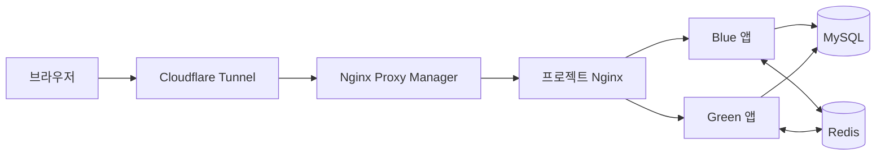
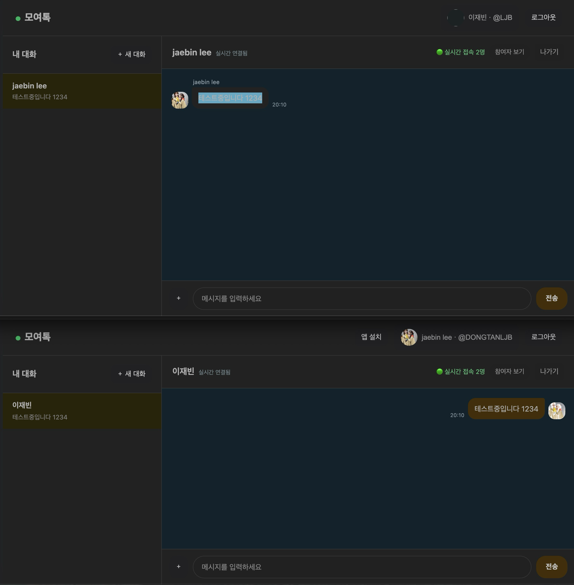
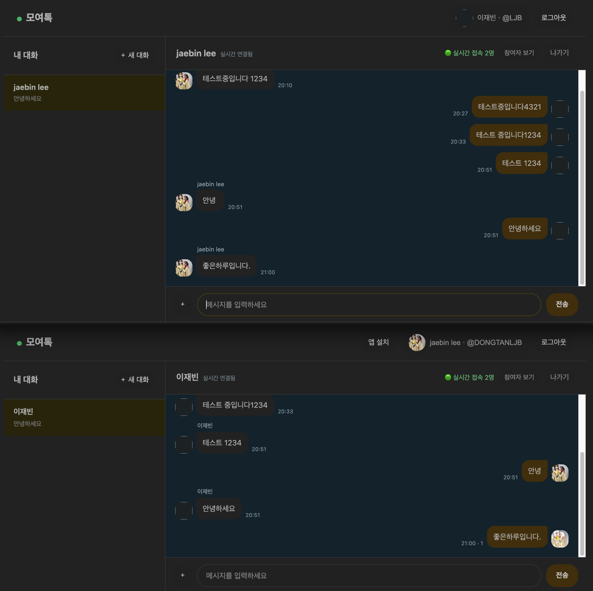

# 이재빈 | 백엔드 개발 포트폴리오

Java와 Spring 기반으로 웹 서비스를 개발하고, 데이터 저장·실시간 통신·배포 환경까지 연결해 본 경험을 정리했습니다. 아래 대표 프로젝트는 개인·그룹 대화, 메시지 이력, 실시간 접속 상태를 제공하는 채팅 서비스 **모여톡**입니다.

## 모여톡

**서버 저장형 실시간 채팅 서비스**

운영 데모: [chatting.ljbhomeserver.date](https://chatting.ljbhomeserver.date)

Google·Kakao OAuth 로그인, 대화방별 접근 권한, WebSocket 메시지 전달, MySQL 대화 이력, Redis 기반 서버 간 이벤트 전달과 접속 상태를 구현했습니다. Docker Compose와 Nginx를 이용해 blue/green 슬롯을 운영하고, 새 슬롯의 헬스 체크가 통과한 뒤 트래픽을 전환하도록 구성했습니다.

### 주요 기능

- Google·Kakao OAuth 로그인 및 Spring Session JDBC 기반 세션 공유
- 1:1·그룹 대화방 생성, 참여자 목록, 대화방 참여 권한 확인
- WebSocket을 이용한 메시지 및 읽음 상태 전달
- MySQL에 메시지 이력을 저장하고 대화방 재진입 시 기록 조회
- Redis Pub/Sub을 통한 앱 인스턴스 간 이벤트 전달
- Redis Sorted Set과 WebSocket heartbeat를 이용한 실시간 접속자 집계
- 이미지·음성 첨부파일 업로드와 접근 권한 확인
- Docker Compose blue/green 배포, Nginx 트래픽 전환 및 Actuator 헬스 체크

### 기술 구성

| 구분 | 기술 |
|---|---|
| 백엔드 | Java 21, Spring Boot 4, Spring Security |
| 데이터 저장 | MySQL 8.4, JdbcTemplate, Flyway |
| 실시간 기능 | WebSocket, Redis Pub/Sub, Redis Sorted Set |
| 세션 | Spring Session JDBC |
| 웹 화면 | HTML, CSS, JavaScript |
| 배포·운영 | Docker Compose, Nginx, Cloudflare Tunnel, Nginx Proxy Manager, Actuator |

### 시스템 구조

각 앱 인스턴스는 자신에게 연결된 WebSocket 세션을 관리합니다. 한 인스턴스에서 메시지를 보내면 서비스가 참여 권한을 확인하고 MySQL에 저장한 뒤 Redis Pub/Sub으로 발행합니다. 다른 인스턴스는 이벤트를 구독해 자신에게 연결된 브라우저에 전달합니다. 로그인 세션은 JDBC로 공유하지만 WebSocket 연결 자체를 서버 간 공유하지는 않습니다.

## 설계와 기술 선택

### JdbcTemplate으로 SQL을 명시적으로 관리

모여톡은 Spring Data JPA 대신 JdbcTemplate을 사용합니다. Repository에서 SQL과 바인딩 파라미터를 직접 관리하고, 조회 결과는 Map·record 등으로 변환합니다. 대화 목록·메시지 조회에 필요한 조인과 정렬을 코드에서 확인할 수 있고, MySQL의 유니크 제약, `INSERT IGNORE`, `ON DUPLICATE KEY UPDATE`, `SELECT ... FOR UPDATE`를 활용합니다.

서비스 계층의 `@Transactional`로 여러 DB 작업의 경계를 정하고, Flyway로 스키마 변경 이력을 관리합니다. 이 선택이 JPA보다 빠르다는 성능 비교를 수행한 것은 아닙니다. JDBC는 SQL과 결과 매핑을 직접 관리해야 하는 비용이 있고, 실제 성능은 쿼리·인덱스·실행 계획으로 별도 확인해야 합니다.

### MySQL과 Redis의 역할 분리

MySQL은 메시지와 읽음 상태의 영속 기록을 보관하고, Redis Pub/Sub은 실행 중인 앱 인스턴스 사이의 실시간 이벤트 전달에 사용합니다. Pub/Sub은 이벤트를 보관하거나 구독자에게 재전송하지 않으므로, Redis 장애 중 실시간 메시지와 읽음 표시가 영향을 받을 수 있습니다. 이 한계를 장애 재현으로 확인했습니다.

### 대화방 권한 확인

대화방 ID를 알고 있는 것만으로 기록이나 첨부파일에 접근할 수 없도록 서비스 계층에서 참여자 여부를 확인합니다. REST 조회, WebSocket 입장·전송, 첨부파일 조회 경로에서 권한을 확인하도록 구성했습니다.

### 배포와 파일 운영

배포 스크립트는 반대편 슬롯에 새 앱을 실행하고 헬스 체크를 통과한 뒤 Nginx upstream을 전환합니다. 앱 슬롯은 MySQL·Redis·공유 업로드 볼륨을 함께 사용합니다. 데이터베이스와 업로드 파일은 별도 저장소이므로 백업도 각각 고려해야 합니다.

## 검증한 사례

### 1. Redis 장애가 메시지·읽음 상태에 미치는 영향

**확인하려던 점:** 메시지 기록 저장과 서버 간 실시간 이벤트 전달이 Redis 장애 시 어떻게 다르게 동작하는지 확인했습니다.

**방법:** 2026년 10월 29일 테스트 환경에서 앱을 로컬 8080·8081 포트로 각각 실행하고, 두 브라우저를 서로 다른 인스턴스에 연결했습니다. Redis를 중지한 상태에서 고유 문구를 전송한 뒤 앱 로그, MySQL 조회 결과, 상대 브라우저 화면을 확인했습니다.

**관찰 결과:**

- 정상 상태에서는 한 인스턴스에서 보낸 메시지가 다른 인스턴스의 브라우저에 표시됐습니다.
- Redis 중단 중에는 Redis 연결 오류가 발생했습니다. 전송한 고유 문구는 MySQL 테스트 DB에서 1건 조회됐습니다.
- 상대 화면에는 Redis 복구 전에 메시지가 나타났지만 즉시 표시되지는 않았습니다. 지연 시간과 표시 경로는 측정·추적하지 않았습니다.
- 상대방이 메시지를 읽은 뒤에도 보낸 사람 화면의 미읽음 표시 `1`이 유지됐습니다.

이 테스트는 DB에 메시지가 기록된 사실과 상대 화면에서 확인된 사실을 보여줍니다. Redis 장애 중 상대 화면에 메시지가 도달한 정확한 경로, 지연 시간, 읽음 시각의 DB 반영 여부까지 증명하지는 않습니다. 장애 대응을 완성한 사례가 아니라, Pub/Sub 장애가 사용자 경험에 미치는 범위와 추가로 확인해야 할 점을 찾은 검증 사례입니다.

*서로 다른 로컬 앱 인스턴스에 연결한 브라우저에서 메시지를 확인한 화면.*

*Redis 중단 중 상대가 메시지를 읽은 뒤 보낸 쪽 화면에 미읽음 표시가 남은 상태.*

### 2. 종료 방식에 따른 실시간 접속 인원 정리 시간

**문제:** 브라우저나 앱이 정상 종료되지 않으면 온라인 인원 수가 실제 접속 상태와 달라질 수 있습니다. 서비스에서는 대화방 참여자(방에 남아 있는 사람)와 실시간 접속자(현재 연결된 사람)를 별도로 표현합니다.

**구현:** 접속 상태는 Redis Sorted Set으로 관리합니다. 앱은 WebSocket heartbeat로 연결을 확인하고, 응답이 끊긴 세션은 정리되도록 구성했습니다. 구현 기준은 15초 간격의 heartbeat, 30초 이상 응답이 없는 연결 종료, 접속 기록 45초 만료입니다.

**검증 결과:** 테스트 환경에서 각 종료 방식을 5회 측정했습니다. 아래는 측정한 값의 중앙값이며, 초 단위 수동 측정이라 오차가 있을 수 있습니다.

| 종료 방식 | 측정값 5회(초) | 중앙값 |
|---|---|---:|
| 로그아웃 버튼 | 0.19, 0.17, 0.18, 0.20, 0.16 | 0.18초 |
| 브라우저 강제 종료 | 0.13, 0.15, 0.13, 0.14, 0.15 | 0.14초 |
| 앱 인스턴스 재시작 | 46.85, 49.69, 44.37, 46.14, 48.95 | 46.85초 |

정상 로그아웃과 브라우저 강제 종료는 빠르게 반영됐지만, 앱 인스턴스 재시작에서는 Redis 접속 정보 만료에 가까운 지연이 관찰됐습니다. 이는 해당 로컬 테스트의 측정 결과이며 다른 네트워크·운영 조건에서 같은 시간을 보장하지 않습니다.

### 3. Offset·커서 페이지네이션 실험 — 진행 중

MySQL 8.4의 합성 메시지 테이블에서 대화방 1의 페이지 크기 50, 깊이 9,000을 조회했습니다. Offset 쿼리는 복합 인덱스를 사용해 50건을 반환하는 동안 인덱스에서 9,050건을 읽었고, 5회 실행 시간의 중앙값은 2.38ms였습니다.

커서 쿼리도 복합 인덱스를 사용해 50건을 반환했지만, 측정 당시 커서 경계가 Offset 페이지의 마지막 행과 일치하지 않았습니다. 따라서 두 방식의 실행 시간이나 정확성을 직접 비교하지 않았고, 커서가 더 빠르다는 결론도 내리지 않았습니다. 다음 단계는 같은 경계 행의 `created_at`과 `id`를 사용해 양쪽 결과 ID와 순서를 대조하는 것입니다.

## 제한 사항과 다음 개선

- Redis Pub/Sub에는 보관·재전송 보장이 없습니다. 더 강한 이벤트 전달 보장이 필요하면 Redis Streams 등 저장형 메시징을 검토할 수 있습니다.
- Redis 장애 중 읽음 표시가 갱신되지 않는 것을 관찰했으며, 장애 복구와 화면 동기화 동작은 추가 검증이 필요합니다.
- 메시지 이력은 방 입장 시 최근 메시지를 조회하는 방식입니다. 깊은 페이지의 커서 정확성 및 성능 비교는 아직 완료하지 않았습니다.
- 채팅 내용은 MySQL에 저장되며 종단 간 암호화(E2EE)는 구현하지 않았습니다.
- 운영 DB와 업로드 볼륨의 백업·복구 훈련, 부하 테스트, 메트릭·알림은 추가 개선 항목입니다.

## 저장소에서 볼 수 있는 내용

- 서버 코드: [app/src/main/java/chatting](app/src/main/java/chatting/)
- DB 마이그레이션: [app/src/main/resources/db/migration](app/src/main/resources/db/migration/)
- Docker·Nginx 배포 구성: [deploy](deploy/)
- 자동 테스트 실행 명령: `./gradlew :app:test`
